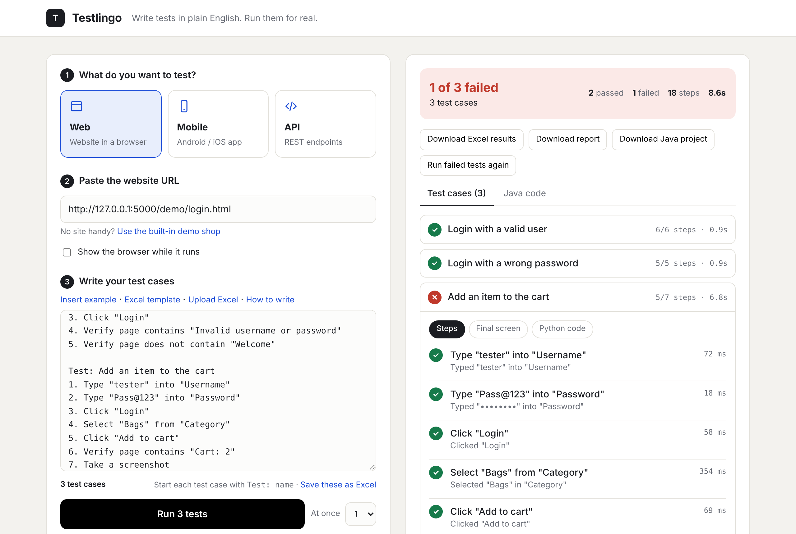
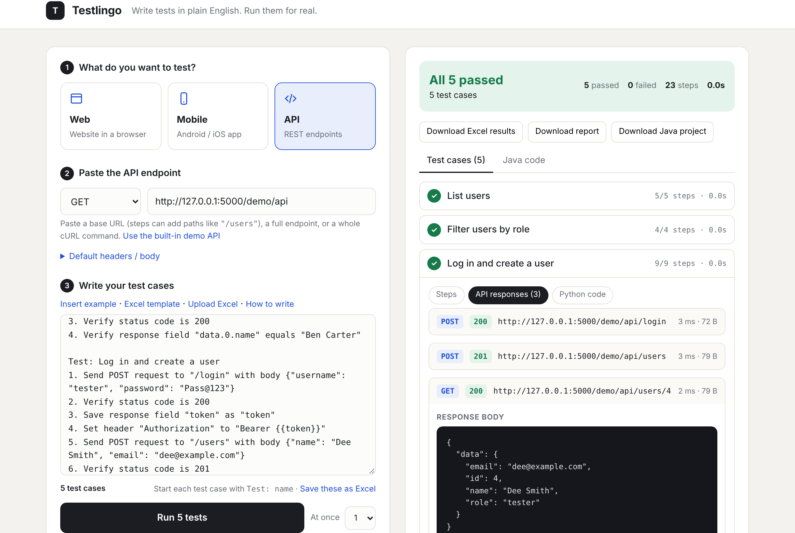
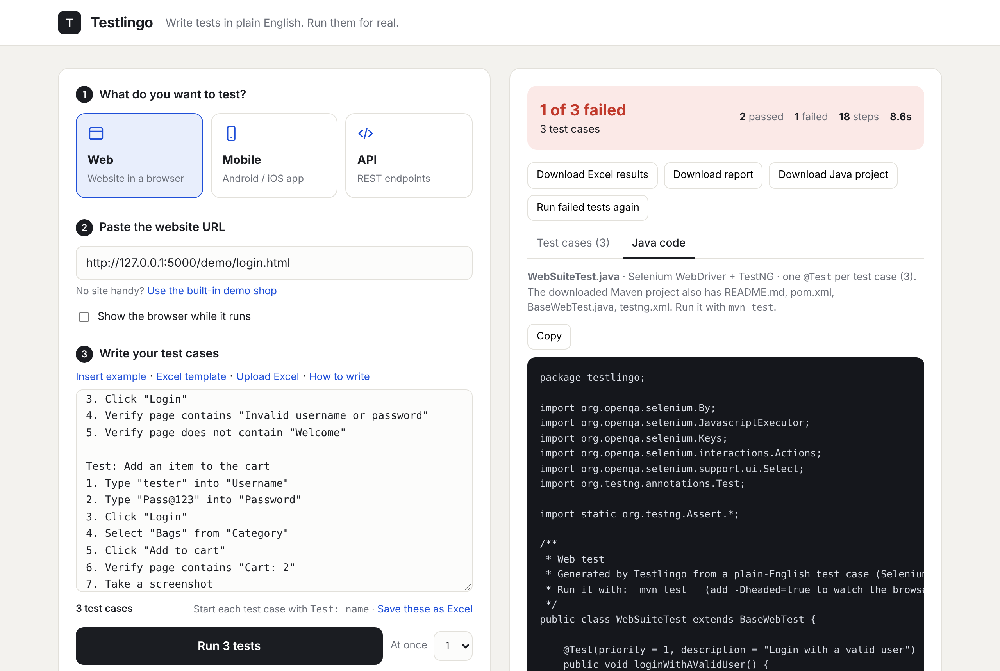

# Testlingo

**Write test cases in plain English. Testlingo runs them for real on websites, mobile apps and REST APIs,
then hands you the results and a ready-to-run Java test.**



## What it does

- **One tool, three platforms** — web (Playwright/Chromium), mobile (Appium: Android and iOS, local or BrowserStack)
  and REST APIs (requests), driven by the same plain-English steps.
- **Natural-language test cases** — `Type "tester" into "Username"`, `Click "Login"`, `Verify page contains "Welcome"`.
  Elements are found by label, placeholder, visible text, accessibility id or resource id, with CSS/XPath as a fallback.
- **Test suites** — many test cases per run, each isolated, optionally in parallel, with live progress, stop, and re-run of failures.
- **Excel in and out** — import test cases from Excel/CSV (two common layouts, Jira/TestRail-style headers),
  download a template with a phrase guide, export results to a three-sheet Excel workbook.
- **Java code generation** — every run produces a Maven project (Selenium / Appium java-client / RestAssured + TestNG)
  with one `@Test` per test case.
- **API chaining** — save values from responses (`Save response field "token" as "token"`) and reuse them (`{{token}}`).
- **Deployable** — Docker image and Render blueprint, with password protection and private-network blocking for public hosting.

| | |
|---|---|
|  |  |
| API test with request / response details | Generated Java (RestAssured + TestNG) |

## How it works

```
plain-English steps ─▶ step parser (regex rules per platform) ─▶ runner ─▶ results, screenshots, responses
                                     │                                        │
                                     └──────────▶ Java generator ─────────────┴─▶ Maven project (TestNG)
```

- `runners/common.py` splits text into test cases and steps (numbering, bullets, Gherkin, Background, Feature).
- `runners/web_runner.py`, `mobile_runner.py`, `api_runner.py` map each step to an action through a list of
  `(regex, handler)` rules and record pass/fail, timing and evidence.
- `runners/java_gen.py` reuses the same rules to emit equivalent Java, so the code matches what ran.
- `app.py` (Flask) runs suites as background jobs with a concurrency limit and serves the single-page UI.

**Tech:** Python, Flask, Playwright, Appium, requests, openpyxl, vanilla JavaScript, Java code generation
(Selenium, Appium java-client, RestAssured, TestNG, Maven), Docker.

## Put it online

To get a public web address you can open from anywhere, follow **[DEPLOY.md](DEPLOY.md)** (GitHub + Render, about 15 minutes).

## 1. Run it on your computer

You need **Python 3.10+**.

**Windows:** double-click `start.bat`
**macOS / Linux:** `./start.sh`

Or by hand:

```bash
python -m venv .venv
# Windows: .venv\Scripts\activate     macOS/Linux: source .venv/bin/activate
pip install -r requirements.txt
python -m playwright install chromium
python app.py
```

Open **http://127.0.0.1:5000**.

### Try it in 30 seconds
The app ships with a small demo shop and demo API so the examples pass straight away:
- **Web** → click *Use the built-in demo shop* → **Run test**
- **API** → click *Use the built-in demo API* → **Run test**

---

## 2. Run many test cases at once

Paste as many test cases as you like into the box. Start each one with a title line:

```
Test: Login with a valid user
1. Type "tester" into "Username"
2. Type "Pass@123" into "Password"
3. Click "Login"
4. Verify page contains "Welcome"

Test: Login with a wrong password
1. Type "tester" into "Username"
2. Type "wrong" into "Password"
3. Click "Login"
4. Verify page contains "Invalid username or password"
```

- Title lines can be `Test: …`, `Test case 2: …`, `Scenario: …` or `TC01: …`. The counter under the box shows how many it found.
- Every test case starts fresh (new browser, new app session, no saved API values) and runs even if another one fails.
- `Feature: …` (or `Suite: …`) names the whole suite. Steps under `Background:` at the top run at the start of every test case.
- **Upload Excel** loads test cases from an `.xlsx` file (or drop the file onto the box). Get a filled-in example with
  the **Excel template** button. Two layouts work, even mixed:
  - one row per test case: `Test Case ID | Title | Steps | Expected Result | Run`, with each step on its own line in the Steps cell (Alt+Enter);
  - one row per step: ID and Title on the first row of each test case (or repeated / merged), one step per row.

  The header row is found even below a title row, every sheet with a Steps column is read, `Run` = N leaves a row out,
  and Expected Result lines that start with *Verify* run as checks (other text is kept as a `#` note).
  Exports from Jira, TestRail, Zephyr or Azure DevOps work if they have a steps column. CSV, `.txt` and `.feature` files work too.
  Old `.xls` files need saving as `.xlsx` first.
- **Save these as Excel** (under the box) saves the test cases in the box as an `.xlsx` in the same layout, so you
  can edit them in Excel and upload them again. With an empty box it gives you the template.
- **Download Excel results** (after a run) gives a workbook with a *Summary* sheet, a *Test cases* sheet
  (status, steps passed, the failed step and why, time) and a *Step details* sheet with every step's result.
- **At once** runs several test cases side by side. The limit is `MAX_PARALLEL_RUNS` (2 by default; 1 on Render's free plan).
- While a suite runs you see each test case's progress and can **Stop** it. Afterwards: **Run failed tests again**,
  **Download report** (one HTML file for the whole suite) and **Download Java project** (one class, one `@Test` per test case).

Runs happen in the background on the server, so long suites don't time out. Results are kept for an hour.

## 3. How to write a test case

- One action per line. Numbering (`1.`), bullets (`-`) and `Given / When / Then` are all fine.
- Put names and values in **"double quotes"**.
- Optional title: `Test: Login works`. Lines starting with `#` are comments.
- The run stops at the first failed step; the remaining steps are marked *skipped*.

### Web example
```
Test: Login with a valid user
1. Open "https://your-site.com/login"
2. Type "tester" into "Username"
3. Type "Pass@123" into "Password"
4. Click "Login"
5. Verify page contains "Welcome"
6. Verify URL contains "dashboard"
7. Take a screenshot
```

| Kind | Phrases |
|---|---|
| Navigate | `Open "/login"` · `Go back` · `Refresh the page` · `Scroll down` / `up` / `to bottom` |
| Act | `Click "Login"` · `Double click "Row"` · `Type "x" into "Email"` · `Clear "Search"` · `Select "Bags" from "Category"` · `Check "Remember me"` · `Uncheck "…"` · `Hover over "Menu"` · `Press Enter` |
| Wait | `Wait 2 seconds` · `Wait for "Done"` |
| Verify | `Verify page contains "x"` · `Verify page does not contain "Error"` · `Verify title contains "x"` · `Verify URL contains "x"` · `Verify "Email" has value "a@b.com"` · `Verify 3 elements ".product"` |
| Other | `Take a screenshot` |

Fields are found by label, placeholder, `name` or `id`; buttons and links by their visible text.
You can always use a CSS selector (`Click "#submit"`) or XPath (`Click "//button[2]"`).

### Mobile example
```
Test: Login on the app
1. Wait for "Login"
2. Type "tester" into "Username"
3. Type "Pass@123" into "Password"
4. Hide keyboard
5. Tap "Login"
6. Verify "Welcome" is displayed
7. Swipe up
8. Take a screenshot
```

| Kind | Phrases |
|---|---|
| Act | `Tap "Login"` · `Long press "Photo"` · `Type "x" into "Username"` · `Type "1234" into "field 2"` · `Clear "Search"` · `Hide keyboard` · `Press back` |
| Move | `Swipe up/down/left/right` · `Scroll to "Settings"` · `Rotate to landscape` · `Put app in background for 3 seconds` |
| Wait | `Wait 2 seconds` · `Wait for "Home"` |
| Verify | `Verify "Welcome" is displayed` · `Verify "Error" is not displayed` · `Verify "Balance" has text "£20"` |

Elements are found by accessibility id, resource id, visible text, hint or content-description; XPath also works.

### API example
```
Test: Users API
1. Send GET request to "/users"
2. Verify status code is 200
3. Verify response field "data" has 3 items
4. Verify response field "data.0.email" equals "asha@example.com"
5. Verify response time is less than 2000 ms
6. Send POST request to "/login" with body {"username": "tester", "password": "Pass@123"}
7. Save response field "token" as "token"
8. Set header "Authorization" to "Bearer {{token}}"
9. Send POST request to "/users" with body {"name": "Dee Smith"}
10. Verify status code is 201
```

| Kind | Phrases |
|---|---|
| Send | `Send GET request to "/users"` · `Send DELETE request to "/users/3"` · `Send POST request to "/users" with body {...}` · `Send GET request` (uses the pasted URL) |
| Set up | `Set header "X-Api-Key" to "abc"` · `Set bearer token "abc"` · `Set query param "page" to "2"` · `Set body {...}` |
| Verify | `Verify status code is 200` · `Verify response time is less than 1000 ms` · `Verify response contains "x"` · `Verify response field "a.b.0.c" equals "x"` · `… has 5 items` · `… is a number` · `… is not empty` · `… does not exist` · `… contains "x"` · `Verify header "Content-Type" contains "json"` |
| Chain | `Save response field "data.id" as "userId"` → use `{{userId}}` in later steps |

If no step sends a request, the URL / method / headers / body you pasted are sent first and your checks run on that response.
Field paths can be written `data.0.email`, `data[0].email` or `$.data[0].email`.

---

## 4. Mobile setup (one time): your own Appium server at http://127.0.0.1:4723

Testlingo must run on the **same computer** as Appium (start.bat / start.sh). The online version can't reach
your computer; use BrowserStack there instead.

1. **Install the tools**
   - Node.js (LTS) from https://nodejs.org
   - A JDK (Java 17 or newer, e.g. Temurin from https://adoptium.net)
   - Android Studio from https://developer.android.com/studio. In *More Actions > SDK Manager*, tick
     **Android SDK Platform-Tools** and **Android SDK Build-Tools** under *SDK Tools*.
2. **Set two environment variables** (Windows: Start > "Edit the system environment variables" > Environment Variables)
   - `ANDROID_HOME` = `C:\Users\<you>\AppData\Local\Android\Sdk` (Mac: `~/Library/Android/sdk`)
   - `JAVA_HOME` = the JDK folder, e.g. `C:\Program Files\Eclipse Adoptium\jdk-17...`
   - Add `%ANDROID_HOME%\platform-tools` to `Path` (Mac: `$ANDROID_HOME/platform-tools` to `PATH`). Open a new terminal afterwards.
3. **Install Appium and the Android driver**
   ```
   npm install -g appium
   appium driver install uiautomator2
   appium driver doctor uiautomator2      # lists anything still missing
   ```
4. **Start a device**: Android Studio > *Device Manager* > create a device (e.g. Pixel 7) > press ▶.
   Or plug in a phone with *Developer options > USB debugging* on and accept the prompt.
   `adb devices` must list it (e.g. `emulator-5554   device`).
5. **Start Appium** in a terminal and leave it open:
   ```
   appium
   ```
6. **In Testlingo**: Mobile > Platform *Android* > Device name e.g. `emulator-5554` (from `adb devices`) >
   paste the app file, path or download URL > *Device service* `http://127.0.0.1:4723` > **Check connection** > run.

| Message | Fix |
|---|---|
| Nothing is answering at http://127.0.0.1:4723 | Appium isn't running: run `appium` and leave the window open. |
| Could not find a driver for automationName 'UiAutomator2' | Run `appium driver install uiautomator2`. |
| ANDROID_HOME / JAVA_HOME is not set | Step 2, then close and reopen the terminal and restart `appium`. |
| Could not find a connected Android device | Start the emulator (step 4); `adb devices` must show it. |
| Could not find "..." on the screen | Open the app in Appium Inspector and copy the element's text or id into the step. |

To see element names and ids, install **Appium Inspector** (https://github.com/appium/appium-inspector/releases),
connect it to `http://127.0.0.1:4723` with the same device and app, and tap an element.

iOS needs a Mac with Xcode: `appium driver install xcuitest`, boot a simulator, then choose Platform *iOS*.

## Java tests

After every run, open the **Java code** tab. **Download Java project** gives a Maven project:

```
testlingo-web-java/
  pom.xml                 Selenium / Appium / RestAssured + TestNG
  testng.xml
  src/test/java/testlingo/<YourTest>.java     one block per plain-English step
  src/test/java/testlingo/BaseWebTest.java    (web)    browser set-up + field("..."), clickable("...")
  src/test/java/testlingo/BaseMobileTest.java (mobile) driver set-up + find("..."), swipe(...)
```

Run it with Java 17+ and Maven: `mvn test` (web: add `-Dheaded=true` to watch the browser;
API: `-DbaseUri=...` for another server, `-Dlog=true` to print requests and responses).
Values you save in an API test (`Save response field "id" as "userId"`) become Java variables.
Steps Testlingo can't convert become a `// TODO` with `fail(...)` so they're never skipped silently.

The Java test is generated from your steps with the same rules Testlingo uses to run them,
so it includes every step, even ones that failed in the run.

## Change the name

The name in the header, browser tab and reports comes from the `APP_NAME` setting (default **Testlingo**).
Set it before starting, e.g. Windows `set APP_NAME=QA Studio` then `start.bat`, Mac/Linux `APP_NAME="QA Studio" ./start.sh`,
or on Render under **Environment**. To change the default for good, edit `APP_NAME` near the top of `app.py`.
`APP_TAGLINE` changes the line next to the name (empty hides it).

## Project layout

```
app.py                 Flask server: UI, run endpoints, demo shop + demo API
templates/index.html   The website (single page)
runners/common.py      Splits the test case into steps, runs them, collects results
runners/web_runner.py  English → Playwright
runners/mobile_runner.py English → Appium
runners/api_runner.py  English → HTTP requests
runners/java_gen.py    English → Java (Selenium / Appium / RestAssured + TestNG) Maven project
runners/java_templates/ Base classes copied into each Java project
demo/                  Demo shop pages used by the web example
```

**Adding your own phrase:** each runner has a `HANDLERS` list of `(regex, function)` pairs.
Add a pattern and a small function that performs the action and returns `(message, generated_code)`.

**Note:** this is meant to run on your own computer or a private network — it opens whatever
URLs and apps you give it, so don't expose it to the public internet without adding a login.
